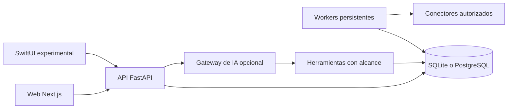

# Arquitectura de Aros

La web Next.js se compila como archivos estáticos y el backend FastAPI los sirve junto con la API. SQLAlchemy mantiene usuarios, recursos, fuentes, propuestas, conversaciones y trabajos. SQLite permite probar localmente; la plantilla de servidor utiliza PostgreSQL. Alembic controla el esquema.

## Propiedad, alcance y evidencia

Los recursos se asocian al usuario autenticado. Antes de usar documentos o resultados derivados se vuelve a comprobar el acceso a la fuente. El contexto de un proyecto se separa del de otras conversaciones. Los contenidos importados nunca constituyen por sí mismos una orden o una autorización.

Un trabajo conserva su estado y progreso en la base. La aceptación de una petición no equivale a ejecución; la ejecución tampoco equivale a resultado verificado. Las propuestas que requieren revisión conservan el flujo de confirmación. Los workers registran heartbeats y usan leases para reducir ejecución concurrente de un mismo trabajo.

## Dos modos de uso

- **Demo local:** datos de ejemplo, SQLite, acceso de demostración y respuestas locales limitadas. No activa proveedores ni sincroniza cuentas.
- **Instancia configurada:** autenticación propia, secretos del operador, proveedores y conectores autorizados expresamente. Las funciones disponibles dependen de esa configuración.

## Áreas heredadas

Estudio, diseño y 3D conservan código especializado de la aplicación original. Identificadores técnicos como `prisma` y `uv` pueden aparecer en rutas y modelos para conservar contratos internos; no significan que existan cuentas o documentos de esas organizaciones dentro de la distribución. El plan de trabajo incluye hacer estas áreas más configurables.

## Persistencia y recuperación

Los secretos de conectores se cifran con la clave de la instalación. Debe conservarse junto con las copias de manera segura: cambiarla sin migración puede impedir recuperar las credenciales. Una copia de la base y una restauración comprobada son requisitos operativos antes de migrar datos reales. No se presume compatibilidad de datos con la aplicación privada de la que procede Aros.
